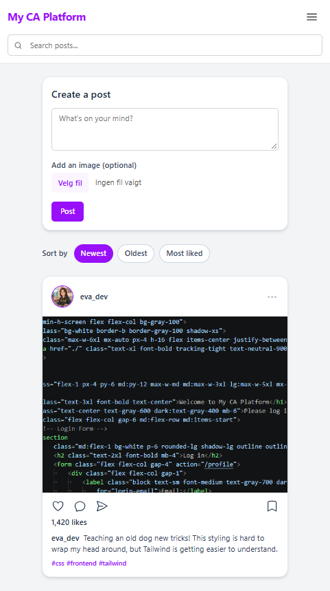

# My CA Platform

A static social media site made for the Noroff CSS Frameworks course assignment (Option 2), styled with Tailwind CSS.



## Pages

- **Login / register** (`/index.html`) – log in or create an account. Forms use HTML validation and send you to `/profile`. Password must be at least 8 characters.
- **Feed** (`/feed/index.html`) – list of posts with images, search bar, sort options and a form to create a new post.
- **Profile** (`/profile/index.html`) – profile picture, username, followers/following, follow button and the user's posts.

## Built with

- HTML
- [Tailwind CSS v4](https://tailwindcss.com/) – installed with npm (no CDN)
- A little JavaScript for the mobile menu
- [Heroicons](https://heroicons.com/) for the icons (inline SVG)

## Getting started

1. Clone the repo:

   ```bash
   git clone https://github.com/evamaran/css-frameworks-social.git
   ```

2. Go into the folder and install the packages:

   ```bash
   cd css-frameworks-social
   npm install
   ```

3. Start the dev script (rebuilds the CSS every time you save):

   ```bash
   npm run dev
   ```

4. Make the production build:

   ```bash
   npm run build
   ```

5. Open `index.html` in the browser (for example with Live Server in VS Code).

## Project structure

```
├── index.html          # Login / register
├── feed/
│   └── index.html      # Feed
├── profile/
│   └── index.html      # Profile
├── css/
│   ├── input.css       # Tailwind input file
│   └── style.css       # Built Tailwind CSS
├── js/
│   └── menu.js         # Mobile menu toggle
├── images/
├── package.json
├── package-lock.json
├── .gitignore
├── README.md
└── AI_LOG.md
```

## Notes

- This is a static site. Nothing actually works behind the scenes: the forms, search, sort, follow and post buttons are only for the look and layout, as the brief asks.
- "Log in" and "Log out" just move between pages. There is no real login.
- The site is responsive for mobile, tablet and desktop. The header with the search bar stays at the top when you scroll.
- I added accessibility details like labels on all form fields, `aria-label` on icon buttons and screen-reader-only headings.
- The brief says to use /profile as the form action. I changed it to ./profile so the login and register forms also work on GitHub Pages, where the site is in a subfolder. It still goes to the profile page, just from where the login page is instead of from the top of the address.

## AI use

I used AI mostly for explaining concepts, brainstorming layout and finding mistakes in my code. All AI use is logged in [AI_LOG.md](AI_LOG.md).

## Author

Eva – Noroff Frontend Development
